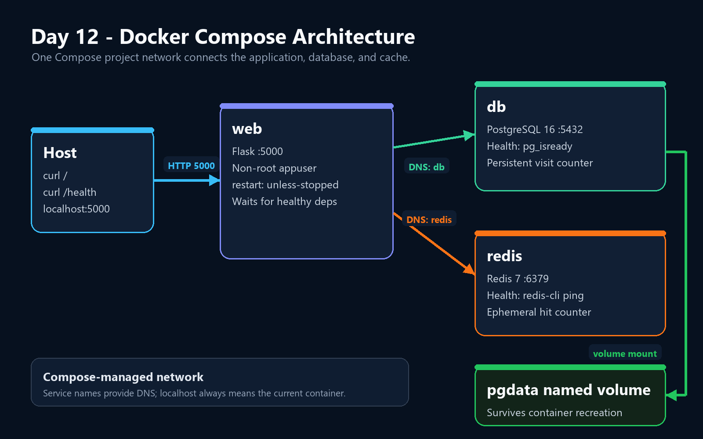

# Day 12 - Docker Compose

This lab defines and runs a three-service application with Docker Compose. A Flask web service connects to PostgreSQL and Redis through Compose service-name DNS, waits for healthy dependencies, preserves database data in a named volume, and restarts after an application failure.

## Architecture



| Service | Purpose | Internal port | Persistence |
|---|---|---:|---|
| `web` | Flask API and counter endpoint | `5000` | Container image only |
| `db` | PostgreSQL visit storage | `5432` | Named volume `pgdata` |
| `redis` | Request hit counter | `6379` | Ephemeral in this lab |

Only the web service is published to the host at `localhost:5000`. Compose creates a project network where the names `db` and `redis` resolve to their respective containers.

## Project Structure

```text
Day-12/
├── app/
│   ├── app.py
│   ├── Dockerfile
│   └── requirements.txt
├── evidence/
├── .env.example
├── .gitignore
├── compose.yaml
└── README.md
```

The real `.env` file is local and ignored by Git. Only `.env.example` is committed.

## Configuration

Create the local environment file from the template and replace the placeholder with a development-only password:

```bash
cp .env.example .env
chmod 600 .env
```

Example variables:

```dotenv
POSTGRES_DB=visits
POSTGRES_USER=appuser
POSTGRES_PASSWORD=replace-with-a-local-password
```

Do not reuse this lab credential or commit `.env`.

## Start the Stack

Validate the Compose model without printing resolved secrets:

```bash
docker compose config --quiet
```

Build and start all services:

```bash
docker compose up -d --build
docker compose ps
```

The expected state is:

- `db` is running and healthy.
- `redis` is running and healthy.
- `web` is running and publishes host port `5000`.

The `web` service uses `depends_on` with `condition: service_healthy`. PostgreSQL is checked with `pg_isready`, and Redis is checked with `redis-cli ping`. The application also retries its initial database connection.

## Test the Application

```bash
curl http://localhost:5000/
curl http://localhost:5000/
curl http://localhost:5000/health
docker compose logs --tail=20 web
```

Observed responses:

```text
Redis hits: 1 | Postgres visits: 1
Redis hits: 2 | Postgres visits: 2
ok
```

Both counters increased with repeated requests, and the logs recorded HTTP `200` responses.

## Persistence Test

The stack was removed without deleting its named volume and then recreated:

```bash
docker compose down
docker compose up -d
curl http://localhost:5000/
```

Observed response after recreation:

```text
Redis hits: 1 | Postgres visits: 3
```

The PostgreSQL count continued from `2` to `3` because `pgdata` survived container removal. The Redis count reset because this lab does not attach a volume to Redis.

## Service Discovery Test

DNS resolution and TCP connectivity were tested from the web container:

```bash
docker compose exec -T web python - <<'PY'
import socket

for host, port in [("db", 5432), ("redis", 6379)]:
    address = socket.gethostbyname(host)
    print(f"{host} resolves to {address}")
    with socket.create_connection((host, port), timeout=3):
        print(f"{host}:{port} connection successful")
PY
```

Observed results:

```text
db resolves to 172.20.0.2
db:5432 connection successful
redis resolves to 172.20.0.3
redis:6379 connection successful
```

Inside `web`, `localhost` refers to the web container itself. The application therefore connects to its dependencies using the Compose service names `db` and `redis`.

## Restart Policy Test

The service uses:

```yaml
restart: unless-stopped
```

Running `docker kill` stopped the container manually, so Docker did not apply the restart policy. The observed state was `Exited (137)` with `Restarts=0`. This is expected Docker behavior for a manually stopped container.

To test an actual application failure, a temporary lab-only endpoint made the Flask PID 1 process exit. The endpoint was removed immediately after the test and the clean image was rebuilt.

Observed recovery:

```text
Before: Status=running Restarts=0 Policy=unless-stopped
curl: (52) Empty reply from server
Attempt 1: Status=restarting Restarts=1
Attempt 2: Status=running Restarts=1
Redis hits: 4 | Postgres visits: 6
After: Status=running Restarts=1
```

The empty reply occurred when Flask exited during the test request. Docker restarted the same container, and the application became reachable again.

## Troubleshooting Notes

### Connection reset immediately after recreation

The first health request ran when the new web container had been up for less than one second. A bounded readiness loop succeeded on its first retry:

```bash
for attempt in {1..20}; do
  if response="$(curl --fail --silent http://localhost:5000/health)"; then
    echo "Attempt $attempt: $response"
    break
  fi
  sleep 1
done
```

### Manual kill did not trigger restart

Docker suppresses restart policies after a manual stop. A valid restart test must cause the main application process to exit rather than stopping the container through the Docker CLI.

### Compose Bake warning

Compose reported that Bake was configured but Buildx was not installed. The standard builder completed the image successfully, so this warning did not block the lab.

### Local credentials

The repository-level ignore rules also matched `.env.example`. A local negation rule was added so the placeholder can be committed while `.env` remains ignored:

```gitignore
.env
!.env.example
```

Verification showed:

```text
?? .env.example
!! .env
```

## Useful Commands

```bash
# Validate configuration
docker compose config --quiet

# Start or rebuild
docker compose up -d --build

# Inspect services and logs
docker compose ps
docker compose logs --tail=50 web

# Stop and remove containers while preserving pgdata
docker compose down

# Also delete project volumes and stored data - destructive
docker compose down -v
```

## Evidence

| Evidence | What it proves |
|---|---|
| [Compose validation](evidence/01-compose-validation.png) | YAML structure and successful validation |
| [Compose build](evidence/02-compose-build.png) | Web image build and dependency health |
| [Compose status](evidence/03-compose-status.png) | Three running services and published port |
| [Application responses](evidence/04-app-responses.png) | Increasing counters, health response, and HTTP logs |
| [Persistence test](evidence/05-persistence-test.png) | PostgreSQL count continued after `down` and `up` |
| [Restart policy](evidence/06-restart-policy.png) | Application recovered with `Restarts=1` |
| [Service DNS](evidence/07-service-dns.png) | `db` and `redis` resolution and connectivity |
| [Git hygiene](evidence/08-git-hygiene.png) | `.env` ignored and `.env.example` allowed |
| [Architecture](evidence/09-architecture.png) | Service, network, health, and storage relationships |

## Reflection

### What does each service do?

`web` handles HTTP requests and updates both counters. `db` stores durable visit records. `redis` maintains a fast, temporary hit counter.

### How does the web service discover PostgreSQL and Redis?

Compose connects the services to a project network with DNS. The service names `db` and `redis` become resolvable hostnames.

### What proves that dependencies were ready before the application started?

Both dependency containers reported healthy before Compose started `web`. The Compose file requires `service_healthy`, and the application also completed a PostgreSQL `SELECT 1` during startup.

### Why did PostgreSQL persist while Redis reset?

PostgreSQL stores its data in the separately managed `pgdata` volume. Redis has no volume in this lab, so its in-container state can disappear when the container is recreated.

### What should change before production deployment?

- Replace Flask's development server with a production WSGI server such as Gunicorn.
- Use a secret manager instead of a local `.env` password.
- Make `/health` verify PostgreSQL and Redis connectivity.
- Add resource limits, structured logs, metrics, backups, and restore testing.
- Place the service behind TLS and publish only required ports.
- Pin images by digest and add automated vulnerability scanning.

## Cleanup

```bash
docker compose down
```

This removes the containers and Compose network while retaining `pgdata` for later inspection.
