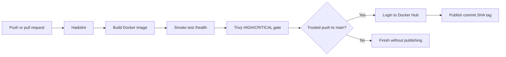

# Day 14 - Docker in CI/CD

This lab builds a secure Docker delivery pipeline for a small Flask API. Every relevant push or pull request runs Dockerfile linting, image build, a `/health` smoke test, and a Trivy vulnerability gate. Trusted pushes to `main` publish an immutable commit-SHA tag to Docker Hub.

## Pipeline



A failed lint, build, health check, or vulnerability policy stops the later stages.

## Application

The Flask API provides:

- `GET /` - returns the application message and environment.
- `GET /health` - returns `ok` with HTTP 200.
- Non-root execution with UID and GID `10001`.
- `APP_ENV` runtime configuration.

## Local Build and Test

```bash
docker build -t winter-arc-app:local .

docker run -d \
  --name day14-local-api \
  -p 5002:5000 \
  -e APP_ENV=local \
  winter-arc-app:local

curl -f http://localhost:5002/health
curl -s http://localhost:5002/
docker exec day14-local-api id
docker rm -f day14-local-api
```

## CI/CD Workflow

The workflow is stored at:

```text
.github/workflows/day14-docker-ci.yml
```

It runs when changes affect `Day-14/**` or the workflow itself.

Pipeline stages:

1. Check out the repository.
2. Lint `Day-14/Dockerfile` with Hadolint.
3. Build the image with Docker Buildx.
4. Start the container and test `/health`.
5. Scan for unfixed `HIGH` and `CRITICAL` vulnerabilities with Trivy.
6. For a trusted push to `main`, authenticate to Docker Hub.
7. Publish `raisaksham04/winter-arc-app:<full-commit-sha>`.

## Required GitHub Secrets

The repository uses these GitHub Actions secrets:

```text
DOCKERHUB_USERNAME
DOCKERHUB_TOKEN
```

Only the secret names are documented. Secret values must never appear in source files, workflow logs, screenshots, or commits.

## Published Image

Docker Hub repository:

https://hub.docker.com/r/raisaksham04/winter-arc-app

After a successful main-branch workflow, obtain the immutable tag with:

```bash
git rev-parse HEAD
```

Then pull and test that exact release:

```bash
FULL_COMMIT_SHA="<successful-commit-sha>"

docker pull "raisaksham04/winter-arc-app:${FULL_COMMIT_SHA}"

docker run -d \
  --name published-api \
  -p 5003:5000 \
  "raisaksham04/winter-arc-app:${FULL_COMMIT_SHA}"

curl -f http://localhost:5003/health
docker rm -f published-api
```

## Rollback

A rollback redeploys a previously tested immutable image rather than rebuilding changed source code.

```bash
PREVIOUS_GOOD_SHA="<previous-known-good-sha>"

docker pull "raisaksham04/winter-arc-app:${PREVIOUS_GOOD_SHA}"

docker rm -f winter-app 2>/dev/null || true

docker run -d \
  --name winter-app \
  -p 5002:5000 \
  --restart unless-stopped \
  "raisaksham04/winter-arc-app:${PREVIOUS_GOOD_SHA}"

curl -f http://localhost:5002/health
```

Keep the current and previous known-good SHA values in release notes before each deployment.

## Security Controls

- The Docker Hub token is stored only in GitHub Actions secrets.
- Pull requests lint, build, test and scan, but do not publish.
- Publishing is restricted to pushes to `main`.
- Trivy blocks publishing when fixable `HIGH` or `CRITICAL` vulnerabilities are found; vulnerabilities without an available fix are reported but ignored by the gate.
- The application runs as a non-root user.
- Local `.env` files are excluded from Git and the Docker build context.
